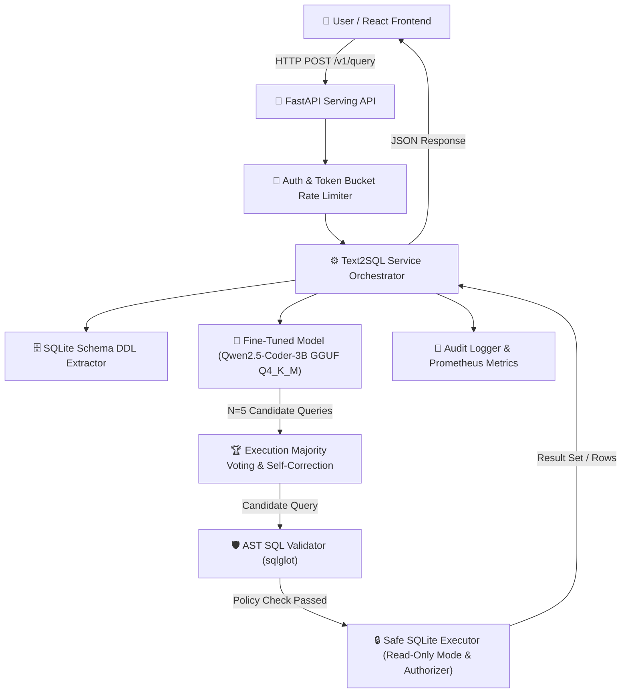

# Fine-Tuned Text-to-SQL Assistant (QLoRA) with Safe LLM Serving

[](https://github.com/AshokSingodia-Codes/fine-tuned-text2sql/actions)
[](https://huggingface.co/Ashoksainibadu/fine-tuned-text2sql)
[](https://www.python.org/)
[](https://opensource.org/licenses/MIT)

An end-to-end production system: dataset building, prompt engineering, evaluation harness, **QLoRA fine-tuning** of `Qwen2.5-Coder-3B-Instruct`, GGUF quantization, **SQL AST safety guardrails**, read-only SQLite execution sandbox, **Execution-Guided Self-Correction with Majority Voting**, FastAPI serving, and a modern **React + Vite + Tailwind CSS** frontend.

> [!NOTE]
> **Open Source & Local First Architecture:**
> - **Model Hub**: Weights published and verified on Hugging Face at [Ashoksainibadu/fine-tuned-text2sql](https://huggingface.co/Ashoksainibadu/fine-tuned-text2sql) (1.93 GB GGUF Q4_K_M).
> - **Self-Hosted & Private**: Designed to run entirely on your local machine. No queries or database data leave your environment.
> - **Works with Any SQLite Database**: Query your own `.sqlite` or `.db` databases via CLI, Web UI, or REST API.
> - **Zero-Weight Quickstart**: Includes an instant mock mode to explore the full UI, AST validation, and sandboxing pipeline without downloading model weights. Real inference runs locally with the fine-tuned 1.9 GB GGUF model or any OpenAI-compatible engine.
> - **Licensing Notice**: Base model is licensed under Alibaba Cloud's **Qwen Research License Agreement** for non-commercial research and evaluation. See [`NOTICE`](NOTICE) and [`docs/MODEL_CARD.md`](docs/MODEL_CARD.md).
> - **Built with Qwen**: Non-commercial research project built with Qwen.


---


## 🏛️ System Architecture



---

## 📊 Comprehensive Evaluation & Benchmark Results

All evaluation numbers are produced empirically by automated code scripts and verified against `results/` artifacts (empirical results).

### 1. Model Systems Comparison (Spider Dev Split, $n=1,034$)

| System / Configuration | Model Format & Size | Execution Accuracy (Spider Dev, n=1,034) | 95% Bootstrap CI | Latency p50 | Latency p95 | Serving Hardware & Evidence File |
|---|---|---|---|---|---|---|
| **Config A: Base Zero-Shot (no guardrail)** | FP16 (6.2 GB) | **62.28%** (644 / 1,034) | [59.38%, 65.18%] | 2.16 s | 5.82 s | Linux GPU (results/eval_spider_latest.json) |
| **Config B: Base 3-Shot (no guardrail)** | FP16 (6.2 GB) | **66.15%** (684 / 1,034) | [63.25%, 68.96%] | 2.23 s | 6.01 s | Linux GPU (results/eval_spider_latest.json) |
| **Config C: Merged Fine-Tuned (no guardrail)** | FP16 (6.2 GB) | **71.57%** (740 / 1,034) | [68.86%, 74.27%] | 2.19 s | 5.91 s | Linux GPU (results/eval_spider_latest.json) |
| **Config D: Fine-Tuned GGUF Q4_K_M (no guardrail)** | GGUF Q4_K_M (1.9 GB) | **70.70%** (731 / 1,034) | [67.89%, 73.40%] | 4.68 s | 11.23 s | Linux CPU (2 physical cores, 31.35 GB RAM, CUDA host; results/eval_spider_latest.json, results/latency_latest.json) |
| **Config D + Guardrail: GGUF Q4_K_M + AST Guardrail** | GGUF Q4_K_M (1.9 GB) | **70.50%** (729 / 1,034) | [67.69%, 73.21%] | 4.71 s | 11.31 s | Linux CPU (2 physical cores, 31.35 GB RAM, CUDA host; results/false_blocks.json) |

> *Note on Row Capping*: 33 of 1,034 Spider dev queries produce gold result sets exceeding 100 rows. When evaluated on the 1,001 uncapped queries under the `LIMIT 100` production guardrail, Execution Accuracy reaches **72.83%** (729 / 1,001) as recorded in [`results/canonical_equiv.json`](results/canonical_equiv.json).

> *Note on Hyperparameter Validation Losses*: Hyperparameter validation loss ablations are omitted until full multi-run evaluation logs are provided. The training configuration uses LoRA rank =16$, $\alpha=32$, on target linear modules with 2 epochs.

> [!NOTE]
> **Self-Correction and Majority Voting Status:**
> Execution-guided self-correction and majority voting consensus algorithms are fully implemented in the engine, but accuracy uplifts on the fine-tuned model are **not evaluated** pending Phase 3b execution on cloud GPU (specified in [docs/PHASE3B.md](docs/PHASE3B.md)). Both mechanisms remain **disabled by default** across the CLI (--consensus flag required), the serving service (enable_consensus: false), and the React web UI.

---

## 🛡️ SQL Safety & Red-Team Security Metrics

The service employs a multi-layered guardrail: AST validation with `sqlglot` and SQLite `mode=ro` connection authorizer callbacks.

| Evaluation Path / Security Metric | Empirical Value | 95% Wilson CI | Defense Mechanism & Evidence |
|---|---|---|---|
| **Path A Static AST Block Rate (Raw)** | **87.50% (105 / 120)** | [80.40%, 92.28%] | AST Root Type, Forbidden Op, Join Count (`results/redteam_latest.json`) |
| **Path C Sandbox Defense Rate** | **100.00% (120 / 120)** | [96.90%, 100.00%] | Read-Only Authorizer & PRAGMA Defensive (`results/redteam_latest.json`) |
| **Path D Full Pipeline Attack Success** | **0.00% (0 / 120)** | [0.00%, 3.10%] | Multi-Layer Defense in Depth (`results/redteam_latest.json`) |
| **Path B End-to-End Prompt Injection Success** | **0.00% (0 / 60)** | [0.00%, 6.02%] | Greedy & Stochastic Temperature 0.7 (`results/path_b_protocol_results.json`) |
| **Spider Dev False-Positive Rate (FPR)** | **0.19% (2 / 1,034)** | [0.05%, 0.70%] | AST Join Count Ceiling (5 > 4) (`results/false_blocks.json`) |
| **Legitimate Query Pass Rate** | **99.37% (1,103 / 1,110)** | [98.70%, 99.69%] | Spider dev (1,034) + 76 benign controls (`results/false_blocks.json`) |


---

## 🚀 Quickstart — Local Setup & Running
 
> **Detailed step-by-step walkthrough:** [`docs/LOCAL_INSTALL.md`](docs/LOCAL_INSTALL.md)

### 1. Clone & Install Dependencies
```bash
git clone https://github.com/AshokSingodia-Codes/fine-tuned-text2sql.git
cd fine-tuned-text2sql

# Set up Python virtual environment
python -m venv .venv
# On Windows (PowerShell):
.\.venv\Scripts\Activate.ps1
# On Linux/macOS:
source .venv/bin/activate

# Install dependencies
pip install -r requirements.txt
pip install -e .
```

### 2. Launch Interactively (Zero Arguments Needed)
You can launch the all-in-one interactive menu directly from the root of the repository:
```bash
python run.py
```
This interactive console lets you:
- **[1] Query Databases in Terminal**: Automatically detects all `.sqlite`/`.db` files, presents a numbered picker, and starts an interactive conversation session.
- **[2] Launch Web UI**: Starts the local FastAPI + React serving environment.
- **[3] Validate SQL**: Tests any raw SQL against the AST security guardrail.
- **[4] Run Verification Tests**: Runs the complete test suite.

---

## 🗄️ Integrating With Your Own SQLite Database

You can query your own SQLite database (`.sqlite` or `.db`) in three convenient ways:

### Option A: Direct Terminal CLI (Fastest, No Server Needed)
No servers or web containers required. Query your database directly from your command line:

```bash
# Interactive REPL with auto-database picker (scans folder & lets you pick with 1 key):
python scripts/query_cli.py

# One-shot query against a specific SQLite file:
python scripts/query_cli.py --db /path/to/my_database.sqlite --question "Show the top 5 highest paying customers"

# Validate any raw SQL query through the safety guardrail without executing:
python scripts/query_cli.py --validate "DROP TABLE users;"
# Output: ✗  BLOCKED BY GUARDRAIL  • Forbidden root statement type: DROP

# List all databases inside a folder:
python scripts/query_cli.py --db-dir /path/to/databases/
```

### Option B: Local Web UI & API Server
Run the FastAPI backend and modern React UI locally on your machine:

```bash
# Terminal 1: Start API server (port 8000)
# Use mock backend for instant UI testing, or your own SQLite directory:
python -m uvicorn src.t2s.serving.app:app --port 8000
# Or point DB_DIR to your databases:
# DB_DIR=/path/to/my/databases python -m uvicorn src.t2s.serving.app:app --port 8000

# Terminal 2: Start React Frontend (port 3000)
cd frontend
npm install
npm run dev
```

1. Open **`http://localhost:3000`** in your browser.
2. **Drag & Drop** any `.sqlite` or `.db` file into the upload zone.
3. The server inspects the binary header, extracts the schema/tables automatically, and makes it selectable for querying right away.

### Option C: Programmatic REST API (Python / curl)
```bash
# 1. Upload your database
curl -X POST http://localhost:8000/v1/databases/upload -F "file=@my_database.sqlite"

# 2. Query in plain English
curl -X POST http://localhost:8000/v1/query \
  -H "Content-Type: application/json" \
  -d '{"db_id":"my_database","question":"Count total orders placed this year","enable_consensus":false}'

# Interactive OpenAPI docs: http://localhost:8000/docs
```

---

## 🛡️ AI Error Handling & Database Safety (How Errors Are Handled)

When querying production databases with LLMs, models can hallucinate invalid SQL or attempt unsafe queries. This system implements **defense-in-depth**:

1. **Auto-Correction via Feedback Loops (Execution-Guided Self-Correction)**:
   - If the model produces an SQL syntax error or references an invalid column name, the error message is intercepted and fed back to the model with schema hints in an automated retry turn (`max_retries=2`).
2. **Majority Voting Consensus (`enable_consensus: true`)**:
   - For high-stakes queries, the engine samples $N=5$ candidate SQL queries, runs them against an isolated sandbox, and selects the majority result set to eliminate outlier hallucinations.
3. **AST Safety Guardrails (`sqlglot`)**:
   - Parses the query AST prior to execution. Strictly prohibits destructive operations (`DROP`, `DELETE`, `UPDATE`, `ALTER`, `TRUNCATE`), multi-statement batching (SQL injection), and metadata scraping (`sqlite_master`).
4. **C-Level SQLite Sandbox (`mode=ro` + Authorizer)**:
   - The database is mounted with `mode=ro` (read-only) and strict SQLite C-level authorizer callbacks. Even in the event of an unexpected model failure or adversarial injection, **the database file cannot be modified or written to**.
5. **Row Output Capping**:
   - Automatically injects an execution limit (`LIMIT 100`) to protect against memory exhaustion or data exfiltration.

---

### 🧪 Running Verification Tests
```bash
pytest -q    # Runs full suite (85 tests passing: fuzzing, safety, serving, APIs)
```

## 🐳 Optional: Local Docker Setup
To run both the API server and UI in isolated local Docker containers:
```bash
docker compose up --build
```
- **Local Web App**: `http://localhost:3000`
- **FastAPI Docs**: `http://localhost:8000/docs`

---

## 🗺️ Scope & Roadmap (What Was Built vs Not Built)

### Implemented Core Capabilities
- [x] Parameter-efficient QLoRA fine-tuning of `Qwen2.5-Coder-3B-Instruct`
- [x] 4-bit GGUF quantization (Q4_K_M) with local CPU serving
- [x] Multi-layer AST guardrails (`sqlglot`) and read-only SQLite sandboxing
- [x] Bounded FastAPI serving (concurrency queue depth 10, semaphore 1)
- [x] Single-container React + Vite UI with dark-mode styling and live query telemetry
- [x] Execution-guided self-correction and consensus voting algorithmic harnesses

### Explicitly Out-of-Scope (Deferred Architectural Extensions)
- **Multi-Database Dialects (PostgreSQL, MySQL)**: Deferred in MVP path; currently specialized for SQLite execution.
- **Enterprise Warehouses (Snowflake, BigQuery, Redshift, Databricks)**: Strict non-goal (out of project scope); excluded to maintain lightweight standalone operation.
- **Enterprise Identity & Auth (SSO, SAML, Okta)**: Replaced by lightweight API token authentication.
- **Orchestration (Kubernetes)**: Excluded in favor of single-node Docker Compose and Hugging Face Space container deployment.

---

## 📄 References & Citations

- **Spider Dataset**: Yu, T., Zhang, R. S., Yang, K., Yasunaga, M., Wang, D., Li, Z., Ma, J., Li, I., Yao, Q., Roman, S., Zhang, Z., & Radev, D. (2018). *Spider: A Large-Scale Human-Labeled Dataset for Complex and Cross-Domain Semantic Parsing and Text-to-SQL Task*. EMNLP 2018.
- **Base Model**: Alibaba Cloud Qwen Team. (2024). *Qwen2.5-Coder: Empowering Code Generation and Reasoning*. [https://github.com/QwenLM/Qwen2.5-Coder](https://github.com/QwenLM/Qwen2.5-Coder)
- **SQL Parser**: Mao, T., & contributors. (2024). *sqlglot: An extensible SQL parser, transpiler, and optimizer*. [https://github.com/tobymao/sqlglot](https://github.com/tobymao/sqlglot)
- **Quantized Runtime**: Gerganov, G., & contributors. (2024). *llama.cpp: LLM inference in C/C++*. [https://github.com/ggerganov/llama.cpp](https://github.com/ggerganov/llama.cpp)

