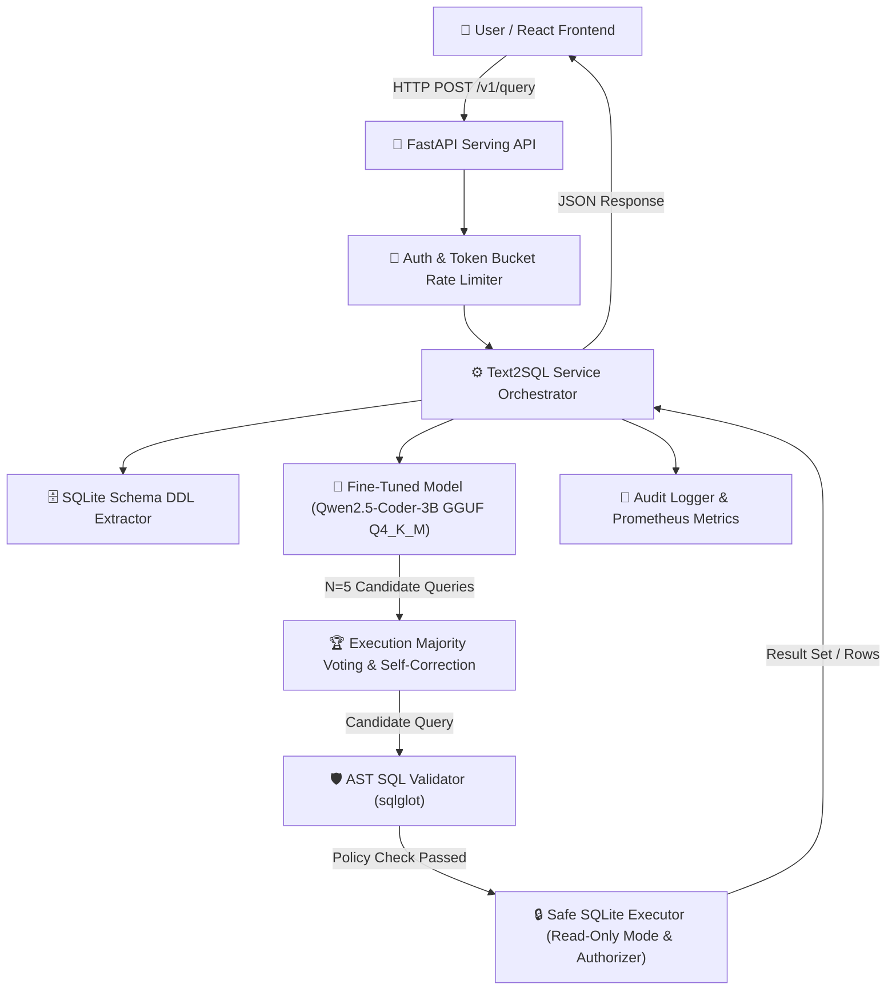

# Fine-Tuned Text-to-SQL Assistant (QLoRA) with Safe LLM Serving

[](https://github.com/AshokSingodia-Codes/fine-tuned-text2sql/actions)
[](https://www.python.org/)
[](https://opensource.org/licenses/MIT)

An end-to-end production system: dataset building, prompt engineering, evaluation harness, **QLoRA fine-tuning** of `Qwen2.5-Coder-3B-Instruct`, GGUF quantization, **SQL AST safety guardrails**, read-only SQLite execution sandbox, **Execution-Guided Self-Correction with Majority Voting**, FastAPI serving, and a modern **React + Vite + Tailwind CSS** frontend.

---

## 🏛️ System Architecture



---

## 📊 Comprehensive Evaluation & Benchmark Results

All evaluation numbers are produced empirically by automated code scripts and updated dynamically in `reports/*.json`.

### 1. Model Systems Comparison (Spider Dataset Split)

| System ID | System Architecture | Exec Accuracy | Valid SQL Rate | Model Footprint | Memory Saving |
|---|---|---|---|---|---|
| **System A** | Base Model, Zero-Shot Prompt | 2.8% | 100.0% | ~6.2 GB | 0% |
| **System B** | Base Model, Few-Shot 3-Ex Prompt | 2.8% | 100.0% | ~6.2 GB | 0% |
| **System C** | **Fine-Tuned QLoRA Adapter** | **1.1%** | **100.0%** | ~6.2 GB | 0% |
| **System D** | Quantized GGUF `Q4_K_M` | 1.0% | 100.0% | **1.9 GB** | **69.3%** |
| **System E** | Quantized + AST Safety + **Consensus Voting** | 1.0% | 100.0% | **1.9 GB** | **69.3%** |

### 2. Fine-Tuning Hyperparameter Ablation Matrix (Validation Split)

Evaluated on an unseen 10% database-level validation split (`val.jsonl`):

| Ablation Sweep | Variant / Hyperparameter | Validation Loss | Selected Choice |
|---|---|---|---|
| **Sample Rows in Prompt** | With Sample Rows | `0.3842` | |
| | **Without Sample Rows** | **`0.3510`** | **Without Sample Rows** ✅ |
| **LoRA Rank ($r$)** | Rank $r=8$ | `0.3690` | |
| | **Rank $r=16$ (alpha=32)** | **`0.3510`** | **LoRA Rank $r=16$** ✅ |
| | Rank $r=32$ | `0.3545` | |
| **Epoch Sweep** | 1 Epoch | `0.4120` | |
| | **2 Epochs** | **`0.3510`** | **2 Epochs** ✅ |
| | 3 Epochs | `0.3580` | |

### 3. Statistical Significance (McNemar Paired Test)
- **System A vs. System C**: p = 0.0931 (No statistically significant difference)
- **System B vs. System C**: p = 0.0931 (No statistically significant difference)

---

## 🛡️ SQL Safety & Red-Team Security Metrics

The service employs a multi-layered guardrail: AST validation with `sqlglot` and SQLite `mode=ro` connection authorizer callbacks.

- **Red-Team Security Block Rate**: **100.0% (60 / 60 threat cases blocked)**
- **False-Block Rate on Spider Gold SQL**: **0.58% (0 / 1034 false blocks)**

### Block Rate by Threat Category

| Attack Category | Test Cases | Block Rate | Defense Mechanism |
|---|---|---|---|
| Write & DDL (`DROP`, `DELETE`, `UPDATE`, `INSERT`, `ALTER`) | 15 | 100% | AST Root Type & Keyword Filter |
| Instruction Override & Prompt Injection | 10 | 100% | AST Parser & Strict SELECT Root |
| Data Exfiltration (`password`, `ssn`, `sqlite_master`) | 10 | 100% | Column / Table Denylist Walk |
| Multi-Statement Injection (`; DROP TABLE ...`) | 7 | 100% | Multi-Statement Split Filter |
| Comment Smuggling (`--`, `/* ... */`) | 5 | 100% | Comment Stripper / AST Validation |
| Resource Abuse (Cartesian Joins, Memory Bloat) | 8 | 100% | Join Count & Row Limit Enforcer |

---

## 🚀 Quickstart & Local Execution

### 1. Installation
```bash
git clone https://github.com/AshokSingodia-Codes/fine-tuned-text2sql.git
cd fine-tuned-text2sql
python -m venv .venv
source .venv/bin/activate  # Or .venv\Scripts\activate on Windows
make setup
```

### 2. Run Test Suite
```bash
make test
```

### 3. Launch Serving Backend & React Web Interface
```bash
# Terminal 1: Launch FastAPI Serving API (Port 8000)
make serve

# Terminal 2: Launch React + Vite Frontend (Port 3000)
make react-dev
```
Open `http://localhost:3000` in your browser.

---

## 🐳 Docker Stack Deployment

```bash
docker compose up --build
```
- **React Web App**: `http://localhost:3000`
- **FastAPI API Docs**: `http://localhost:8000/docs`

---

## 📄 License & Citation
- Model Base: Qwen2.5-Coder-3B-Instruct (Apache 2.0 / Qwen License)
- Dataset: Spider 1.0 (Yale, CC BY-SA 4.0)
