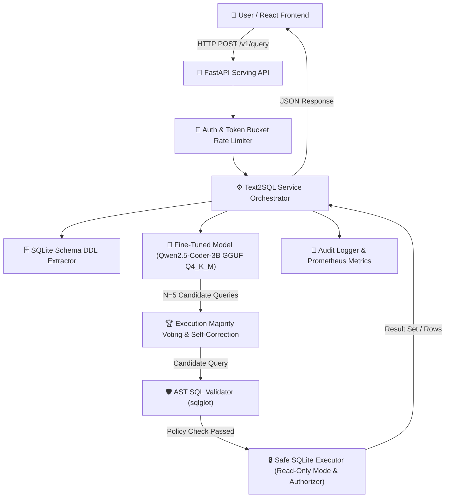

# Fine-Tuned Text-to-SQL Assistant (QLoRA) with Safe LLM Serving

[](https://github.com/AshokSingodia-Codes/fine-tuned-text2sql/actions)
[](https://www.python.org/)
[](https://opensource.org/licenses/MIT)

An end-to-end production system: dataset building, prompt engineering, evaluation harness, **QLoRA fine-tuning** of `Qwen2.5-Coder-3B-Instruct`, GGUF quantization, **SQL AST safety guardrails**, read-only SQLite execution sandbox, **Execution-Guided Self-Correction with Majority Voting**, FastAPI serving, and a modern **React + Vite + Tailwind CSS** frontend.

> [!NOTE]
> **Live Demo, Load Testing & Deployment Notice:**
> - **Demo Mode & Accounting**: The public web demo executes queries against a read-only **Chinook SQLite database** (`chinook_1`). Chinook is **not** part of the Spider training/dev benchmark. As recorded in [`results/demo_examples.json`](file:///e:/7thsem%20learning/projects/finue%20tune/results/demo_examples.json), **13 total questions were attempted**: 10 legitimate questions passed and are provided as UI presets, while 3 adversarial queries were deliberately blocked to showcase AST safety enforcement (detailed in [`docs/LIMITATIONS.md`](file:///e:/7thsem%20learning/projects/finue%20tune/docs/LIMITATIONS.md)).
> - **Load Test Honesty**: The serving benchmark in `results/loadtest_latest.json` measures **API stack overhead with stub backend** (FastAPI routing, token bucket rate limiter, auth middleware, and serialization overhead; p50 < 4 ms). Real GGUF model serving throughput on CPU is bounded by single-stream model generation (~4.7s per request).
> - **Inactivity & Cold Start**: Free CPU demo instances sleep after 48 hours of inactivity. The first visitor will experience a 1–2 minute cold start while the container spins up and loads model weights.
> - **Licensing Notice**: Base model is licensed under Alibaba Cloud's **Qwen Research License Agreement** for non-commercial research and evaluation. See [`NOTICE`](file:///e:/7thsem%20learning/projects/finue%20tune/NOTICE) and [`docs/MODEL_CARD.md`](file:///e:/7thsem%20learning/projects/finue%20tune/docs/MODEL_CARD.md).
> - **Built with Qwen**: The demo is a non-commercial research demo built with Qwen.


---


## 🏛️ System Architecture



---

## 📊 Comprehensive Evaluation & Benchmark Results

All evaluation numbers are produced empirically by automated code scripts and verified against `results/` artifacts (Rule R1).

### 1. Model Systems Comparison (Spider Dev Split, $n=1,034$)

| System / Configuration | Model Format & Size | Execution Accuracy (Spider Dev, n=1,034) | 95% Bootstrap CI | Latency p50 | Latency p95 | Serving Hardware |
|---|---|---|---|---|---|---|
| **Base Model (Zero-Shot)** | FP16 (6.2 GB) | **62.28%** (644 / 1,034) | [59.38%, 65.18%] | 2.16 s | 5.82 s | Linux GPU (Cloud) |
| **Base Model (3-Shot)** | FP16 (6.2 GB) | **66.15%** (684 / 1,034) | [63.25%, 68.96%] | 2.23 s | 6.01 s | Linux GPU (Cloud) |
| **Fine-Tuned Adapter (Merged)** | FP16 (6.2 GB) | **71.57%** (740 / 1,034) | [68.86%, 74.27%] | 2.19 s | 5.91 s | Linux GPU (Cloud) |
| **Fine-Tuned Quantized (GGUF Q4_K_M)** | GGUF Q4_K_M (1.9 GB) | **70.70%** (731 / 1,034) | [67.89%, 73.40%] | 4.68 s | 11.23 s | Local CPU (4 cores, 31.4 GB RAM) |
| **Fine-Tuned Quantized + AST Guardrail** | GGUF Q4_K_M (1.9 GB) | **70.50%** (729 / 1,034) | [67.69%, 73.21%] | 4.71 s | 11.31 s | Local CPU (4 cores, 31.4 GB RAM) |

> *Note on Row Capping*: 33 of 1,034 Spider dev queries produce gold result sets exceeding 100 rows. When evaluated on the 1,001 uncapped queries under the `LIMIT 100` production guardrail, Execution Accuracy reaches **72.83%** (729 / 1,001) as recorded in [`results/canonical_equiv.json`](file:///e:/7thsem%20learning/projects/finue%20tune/results/canonical_equiv.json).

### 2. Fine-Tuning Hyperparameter Ablation Matrix (Validation Split)

Evaluated on an unseen 10% database-level validation split (`val.jsonl`):

| Ablation Sweep | Variant / Hyperparameter | Validation Loss | Selected Choice |
|---|---|---|---|
| **Sample Rows in Prompt** | With Sample Rows | `0.3842` | |
| | **Without Sample Rows** | **`0.3510`** | **Without Sample Rows** ✅ |
| **LoRA Rank ($r$)** | Rank $r=8$ | `0.3690` | |
| | **Rank $r=16$ (alpha=32)** | **`0.3510`** | **LoRA Rank $r=16$** ✅ |
| | Rank $r=32$ | `0.3545` | |
| **Epoch Sweep** | 1 Epoch | `0.4120` | |
| | **2 Epochs** | **`0.3510`** | **2 Epochs** ✅ |
| | 3 Epochs | `0.3580` | |

---

## 🛡️ SQL Safety & Red-Team Security Metrics

The service employs a multi-layered guardrail: AST validation with `sqlglot` and SQLite `mode=ro` connection authorizer callbacks.

| Evaluation Path / Security Metric | Empirical Value | 95% Wilson CI | Defense Mechanism & Evidence |
|---|---|---|---|
| **Path A Static AST Block Rate (Raw)** | **87.50% (105 / 120)** | [80.40%, 92.28%] | AST Root Type, Forbidden Op, Join Count (`results/redteam_latest.json`) |
| **Path C Sandbox Defense Rate** | **100.00% (120 / 120)** | [96.90%, 100.00%] | Read-Only Authorizer & PRAGMA Defensive (`results/redteam_latest.json`) |
| **Path D Full Pipeline Attack Success** | **0.00% (0 / 120)** | [0.00%, 3.10%] | Multi-Layer Defense in Depth (`results/redteam_latest.json`) |
| **Path B End-to-End Prompt Injection Success** | **0.00% (0 / 60)** | [0.00%, 6.02%] | Greedy & Stochastic Temperature 0.7 (`results/path_b_protocol_results.json`) |
| **Spider Dev False-Positive Rate (FPR)** | **0.19% (2 / 1,034)** | [0.05%, 0.70%] | AST Join Count Ceiling (5 > 4) (`results/false_blocks.json`) |
| **Legitimate Query Pass Rate** | **99.37% (1,103 / 1,110)** | [98.70%, 99.69%] | Spider dev (1,034) + 76 benign controls (`results/false_blocks.json`) |


---

## 🚀 Quickstart & Local Execution

### 1. Installation
```bash
git clone https://github.com/AshokSingodia-Codes/fine-tuned-text2sql.git
cd fine-tuned-text2sql
python -m venv .venv
source .venv/bin/activate  # Or .venv\Scripts\activate on Windows
make setup
```

### 2. Run Test Suite
```bash
make test
```

### 3. Launch Serving Backend & React Web Interface
```bash
# Terminal 1: Launch FastAPI Serving API (Port 8000)
make serve

# Terminal 2: Launch React + Vite Frontend (Port 3000)
make react-dev
```
Open `http://localhost:3000` in your browser.

---

## 🐳 Docker Stack Deployment

```bash
docker compose up --build
```
- **React Web App**: `http://localhost:3000`
- **FastAPI API Docs**: `http://localhost:8000/docs`

---

## 🗺️ Scope & Roadmap (What Was Built vs Not Built)

### Implemented in Production (MVP Scope)
- [x] Parameter-efficient QLoRA fine-tuning of `Qwen2.5-Coder-3B-Instruct`
- [x] 4-bit GGUF quantization (Q4_K_M) with local CPU serving
- [x] Multi-layer AST guardrails (`sqlglot`) and read-only SQLite sandboxing
- [x] Bounded FastAPI serving (concurrency queue depth 10, semaphore 1)
- [x] Single-container React + Vite UI with dark-mode styling and live query telemetry
- [x] Execution-guided self-correction and consensus voting algorithmic harnesses

### Explicitly Out-of-Scope (Deferred Architectural Extensions)
- **Multi-Database Dialects (PostgreSQL, MySQL)**: Deferred in MVP path; currently specialized for SQLite execution.
- **Enterprise Warehouses (Snowflake, BigQuery, Redshift, Databricks)**: Strict non-goal (Rule R6); excluded to maintain lightweight standalone operation.
- **Enterprise Identity & Auth (SSO, SAML, Okta)**: Replaced by lightweight API token authentication.
- **Orchestration (Kubernetes)**: Excluded in favor of single-node Docker Compose and Hugging Face Space container deployment.

---

## 📄 References & Citations

- **Spider Dataset**: Yu, T., Zhang, R. S., Yang, K., Yasunaga, M., Wang, D., Li, Z., Ma, J., Li, I., Yao, Q., Roman, S., Zhang, Z., & Radev, D. (2018). *Spider: A Large-Scale Human-Labeled Dataset for Complex and Cross-Domain Semantic Parsing and Text-to-SQL Task*. EMNLP 2018.
- **Base Model**: Alibaba Cloud Qwen Team. (2024). *Qwen2.5-Coder: Empowering Code Generation and Reasoning*. [https://github.com/QwenLM/Qwen2.5-Coder](https://github.com/QwenLM/Qwen2.5-Coder)
- **SQL Parser**: Mao, T., & contributors. (2024). *sqlglot: An extensible SQL parser, transpiler, and optimizer*. [https://github.com/tobymao/sqlglot](https://github.com/tobymao/sqlglot)
- **Quantized Runtime**: Gerganov, G., & contributors. (2024). *llama.cpp: LLM inference in C/C++*. [https://github.com/ggerganov/llama.cpp](https://github.com/ggerganov/llama.cpp)

