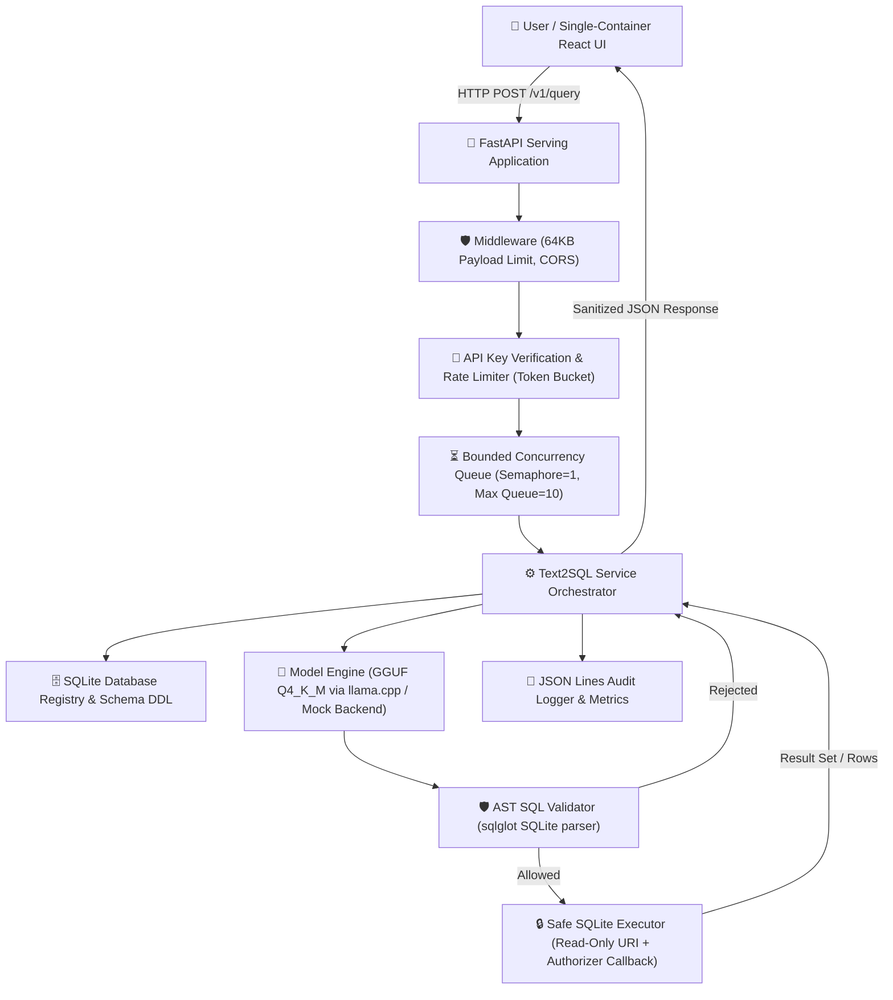
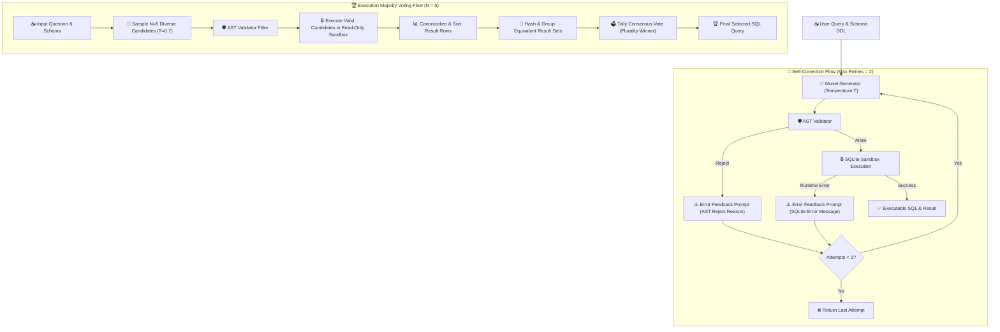

# System Architecture Specification

## 1. High-Level Overview

The **Fine-Tuned Text-to-SQL Assistant** is a guarded LLM serving system for natural language relational querying over SQLite databases.

---

## 2. Serving Limits & Graceful Degradation (Phase 8 MVP)

1. **Concurrency Control:**
   - Single CPU generation at a time (`max_concurrent_generations: 1`) via `asyncio.Semaphore`.
   - Bounded queue (`max_queue_depth: 10`). When queue is full, incoming queries immediately receive **HTTP 503 Service Unavailable** with `Server is at peak capacity`.
2. **Payload & Token Limits:**
   - Max request body: `65,536` bytes (64 KB). Queries exceeding this receive **HTTP 413 Payload Too Large**.
   - Max generated tokens capped at `256`.
3. **Execution Timeout:**
   - Per-request asynchronous generation timeout capped at `30.0` seconds (returns **HTTP 504 Gateway Timeout**).
   - SQLite execution timeout capped at `3.0` seconds in the read-only sandbox.
4. **Rate Limiting:**
   - Token bucket per-user rate limit (default 60 requests/minute) returning **HTTP 429 Too Many Requests**.

---

## 3. SQLite-Only Pipeline & Sandboxing (MVP Scope)

In compliance with scope discipline (MVP Path):
- Database execution is strictly scoped to **SQLite** (PostgreSQL/MySQL deferred).
- **Defense-in-depth:**
  - **Layer 1:** AST inspection (`sqlglot`) enforcing SELECT-only root nodes, join depth ceilings, table allowlists, and function denylists.
  - **Layer 2:** Connection-level read-only URI mode (`file:...sqlite?mode=ro`).
  - **Layer 3:** SQLite authorizer callback permitting only `SQLITE_SELECT`, `SQLITE_READ`, and safe functions.
  - **Layer 4:** Memory row limit capping at `100` rows.

---

## 4. Execution-Guided Self-Correction & Majority Voting (Phase 3 Service)

