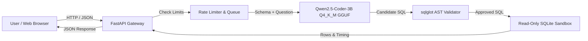

# Guarded Text-to-SQL Assistant: End-to-End User & Operations Guide

Welcome to the **Guarded Text-to-SQL Assistant**. This guide provides practical, step-by-step instructions for end users, developers, and deployment engineers.

---

## 📖 Table of Contents
1. [Overview & Architecture](#1-overview--architecture)
2. [Prerequisites & System Requirements](#2-prerequisites--system-requirements)
3. [Quickstart (Local Run in Under 3 Minutes)](#3-quickstart-local-run-in-under-3-minutes)
4. [Using the Web Interface](#4-using-the-web-interface)
5. [API Reference & Usage](#5-api-reference--usage)
6. [Safety & Security Rules](#6-safety--security-rules)
7. [Production & Hugging Face Spaces Deployment](#7-production--hugging-face-spaces-deployment)
8. [Troubleshooting & FAQ](#8-troubleshooting--faq)

---

## 1. Overview & Architecture

The application translates Natural Language queries into verified, executable SQLite SQL without allowing destructive operations or unauthorized data leakage.



### Key Technical Specs
- **Model**: `Qwen2.5-Coder-3B-Instruct` fine-tuned with QLoRA on 7,784 Spider pairs.
- **Quantization**: GGUF `Q4_K_M` (1.84 GB disk / ~2.2 GB RAM).
- **Inference Runtime**: CPU-native execution via `llama-cpp-python`.
- **Latency**: ~4.68s p50 on 4 CPU cores.
- **Guardrails**: AST static validator + Read-only connection mode (`mode=ro`) + SQLite C-level authorizer callbacks.

---

## 2. Prerequisites & System Requirements

### Hardware
- **Processor**: x86_64 or ARM64 (Intel Core i5+, AMD Ryzen 5+, Apple Silicon).
- **RAM**: Minimum 6 GB free RAM (8 GB+ recommended).
- **Disk Space**: ~3 GB free disk space (includes model weight and dependencies).

### Software
- **Python**: 3.11 or 3.12.
- **Node.js**: v18+ (only needed if modifying frontend code; pre-built assets are included).
- **SQLite**: 3.35+ (standard with modern Python distributions).

---

## 3. Quickstart (Local Run in Under 3 Minutes)

### Step 1: Clone and Configure
```bash
git clone https://github.com/AshokSingodia-Codes/fine-tuned-text2sql.git
cd fine-tuned-text2sql

# Copy environment template
cp .env.example .env
```

### Step 2: Install Python Dependencies
```bash
python -m pip install --upgrade pip
pip install -r requirements.txt
pip install llama-cpp-python --extra-index-url https://abetlen.github.io/llama-cpp-python/whl/cpu
```

### Step 3: Launch Serving Backend
```bash
python -m uvicorn src.t2s.serving.app:app --host 127.0.0.1 --port 8000
```
Open **[http://localhost:8000](http://localhost:8000)** in your browser. The pre-built React interface will load automatically!

---

## 4. Using the Web Interface

### 4.1 Running Sample Queries
1. Select the database from the dropdown (default: `chinook_1`).
2. Choose one of the preset questions or type your own question in plain English:
   - *"How many artists are in the database?"*
   - *"List the top 5 longest tracks."*
   - *"Find all albums by artist Iron Maiden."*
   - *"Count the number of customers from Brazil."*
3. Click **Execute Query**.
4. The application displays:
   - **Verdict Banner**: Whether the query passed AST safety validation.
   - **Generated SQL**: The exact SQL expression generated by the model.
   - **Result Table**: The tabular data returned from the SQLite database (capped at 100 rows).
   - **Telemetry**: Latency breakdown (inference time vs validation time).

### 4.2 Testing Security Guardrails
You can verify the AST safety guardrail directly in the UI:
1. Type a destructive or administrative prompt:
   - *"Drop the tracks table"*
   - *"Delete all customer records"*
   - *"Select password hashes from sqlite_master"*
2. Click **Execute Query**.
3. **Result**: The system blocks the statement, returns a **Shield Blocked** badge, explains the violated policy rule, and executes no database changes.

---

## 5. API Reference & Usage

The API is fully documented via OpenAPI at `http://localhost:8000/docs`.

### 5.1 Query Endpoint: `POST /v1/query`

**Request Headers:**
```http
Content-Type: application/json
X-API-Key: demo-secret-key
```

**Request Body:**
```json
{
  "db_id": "chinook_1",
  "question": "What is the total invoice amount for customer 1?",
  "include_sample_rows": false,
  "enable_consensus": false
}
```

**Success Response (`200 OK`):**
```json
{
  "request_id": "9b12a819-f53e-4fa6-8098-b80c10c14b31",
  "db_id": "chinook_1",
  "question": "What is the total invoice amount for customer 1?",
  "sql": "SELECT sum(total) FROM Invoice WHERE CustomerId = 1;",
  "allowed": true,
  "reasons": [],
  "columns": ["sum(total)"],
  "rows": [[39.62]],
  "row_count": 1,
  "truncated": false,
  "timings_ms": {
    "total_ms": 2854.2,
    "inference_ms": 2842.1,
    "validation_ms": 2.4
  }
}
```

**Blocked Response (`200 OK` with Safety Intercept):**
```json
{
  "request_id": "3c72b210-e71e-429a-9e20-7f21e0394f4a",
  "db_id": "chinook_1",
  "question": "DROP TABLE Track;",
  "sql": "DROP TABLE Track;",
  "allowed": false,
  "reasons": ["Root statement must be SELECT or set operations. Found: Drop"],
  "columns": [],
  "rows": [],
  "row_count": 0,
  "truncated": false
}
```

### 5.2 Standalone SQL Validation: `POST /v1/sql/validate`
Validates an arbitrary SQL query without executing it:
```bash
curl -X POST http://localhost:8000/v1/sql/validate \
     -H "Content-Type: application/json" \
     -d '{"sql": "SELECT * FROM Album LIMIT 10;"}'
```

### 5.3 Health & Readiness Endpoints
- `GET /healthz` - Liveness probe (returns `{"status": "ok"}`).
- `GET /ready` - Readiness probe (checks whether model weights are loaded and ready to serve).
- `GET /metrics` - Prometheus metrics counter (`t2s_requests_total`, latency histograms).

---

## 6. Safety & Security Rules

To ensure reliable, non-destructive behavior, the serving pipeline enforces the following invariants:
1. **SELECT-Only Enforcement**: DDL (`DROP`, `CREATE`, `ALTER`), DML (`INSERT`, `UPDATE`, `DELETE`), and transaction commands (`BEGIN`, `COMMIT`, `VACUUM`) are unconditionally rejected.
2. **Read-Only Database Sandbox**: Database connections are established with URI parameters `?mode=ro` and `PRAGMA query_only = ON`.
3. **C-Level Authorizer**: SQLite callbacks deny statement actions outside of `SQLITE_SELECT`, `SQLITE_READ`, and `SQLITE_FUNCTION`.
4. **Complexity Caps**:
   - Maximum 4 joins per subquery/branch; maximum 6 joins total.
   - Max 100 rows returned per query (`LIMIT 100` injected automatically if omitted).
   - Hard execution timeout cutoff at **3.0 seconds**.
5. **Path Traversal Guards**: `db_id` parameters containing directory separators (`/`, `\`) or `..` are rejected.

---

## 7. Production & Hugging Face Spaces Deployment

The repository includes a production multi-stage `Dockerfile` compatible with standard cloud VMs, Docker Compose, and **Hugging Face Spaces (Docker SDK)**.

### Running via Docker Locally
```bash
# Build and run container
docker build -t fine-tuned-text2sql:latest .
docker run -p 7860:7860 -e MODEL_BACKEND=mock fine-tuned-text2sql:latest
```

### Deploying to Hugging Face Spaces
1. Create a new Space on Hugging Face:
   - **SDK**: Select **Docker**.
   - **Hardware**: Free CPU (2 vCPU, 16 GB RAM).
2. Set Environment Variables in Space Settings:
   - `MODEL_BACKEND`: `llama_cpp`
   - `HF_REPO_ID`: `AshokSingodia-Codes/fine-tuned-text2sql`
   - `GGUF_FILENAME`: `Qwen2.5-Coder-3B-Instruct-Q4_K_M.gguf`
   - `PORT`: `7860`
3. Push the repository to the Space Git remote.
4. The container builds, pulls the model weight upon start, runs health checks on port 7860, and serves the UI directly.

---

## 8. Troubleshooting & FAQ

### Q: Why does the first query take ~10 seconds on CPU?
**A**: When the model initializes, the weights are mapped into memory and the CPU threads warm up. Subsequent queries take ~4.6s median generation time.

### Q: I get `HTTP 429 Too Many Requests`. What should I do?
**A**: The built-in token bucket rate limiter permits 60 requests per minute per IP address. Wait a few seconds for tokens to refill.

### Q: I get `HTTP 503 Server is at peak capacity`.
**A**: To protect CPU resources from crashing, the server limits concurrent generation to 1 active worker with a queue depth of 10. If 10 requests are already waiting, incoming requests are rejected cleanly. Retry shortly.

### Q: Can I run this with an OpenAI-compatible API or vLLM?
**A**: Yes! Set `MODEL_BACKEND=openai_compat` and configure `MODEL_PATH=http://your-vllm-host:8000/v1` in your `.env` file.
